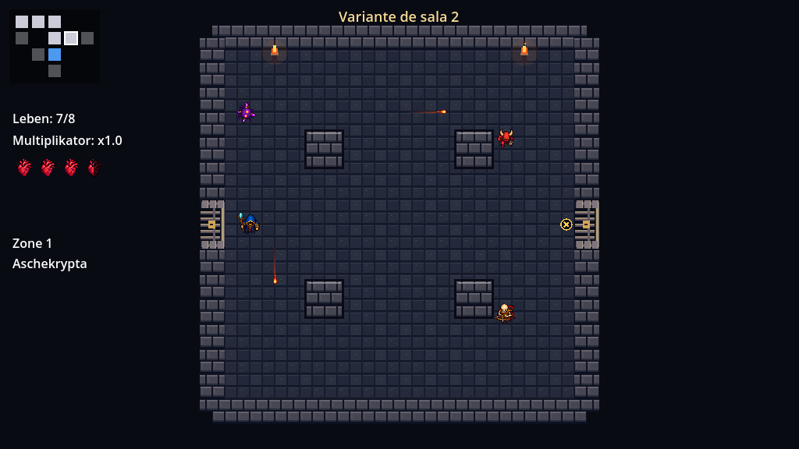
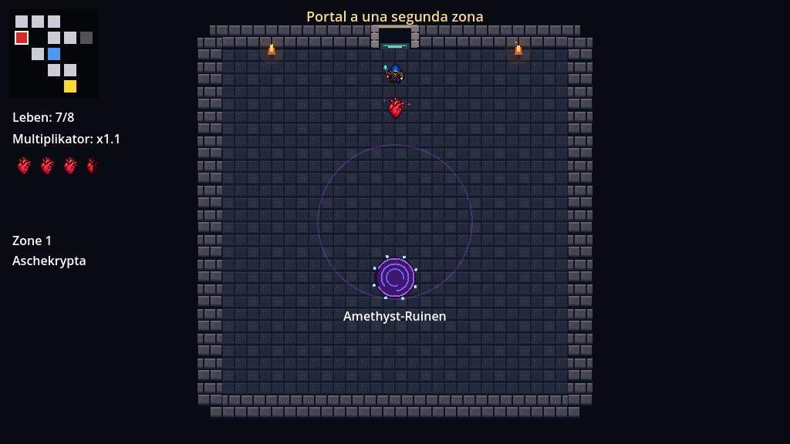
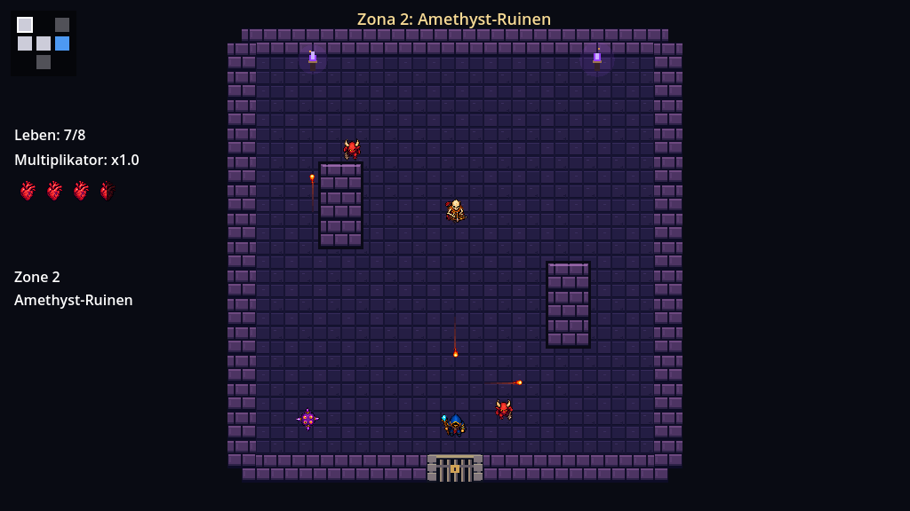

# Kleines Spiel — mazmorras, assets y animaciones

## Abrir y jugar

1. Extrae el ZIP en una carpeta vacía conservando sus subcarpetas.
2. Importa `KleinesSpiel/project.godot` con **Godot 4.3 .NET** y **.NET SDK 8**. La edición estándar no ejecuta C#.
3. Compila con Build del editor o `dotnet build` desde esta carpeta.
4. Pulsa **F5** y selecciona **Spielen**.

WASD: movimiento. Flechas: disparo. Espacio: dash. Escape: pausa. La interfaz mantiene el alemán del proyecto original.

## Estructura de una partida

Cada zona genera un árbol conectado de 12 habitaciones dentro de una cuadrícula de 5 × 5: una inicial, ocho de combate, dos de tesoro y una de jefe. Hay conexiones arriba, abajo, izquierda y derecha. El jefe ocupa una de las hojas más alejadas de la entrada; los tesoros también están en extremos. Los enemigos bloquean las salidas hasta que todos han sido derrotados.

Las ocho salas de combate usan seis distribuciones de obstáculos, barajadas para que las seis aparezcan en cada zona. También varían la selección y posición de los enemigos. Los puntos de aparición evitan los obstáculos y la entrada del jugador. El minimapa muestra la sala actual y las adyacentes descubiertas.

Las salas se conservan durante la visita a una zona: volver no regenera enemigos ni tesoros recogidos, y mantiene los corazones que hayan quedado en el suelo. Los proyectiles se eliminan al cambiar de habitación. Se descartan las salas antiguas al cambiar de zona, reiniciar o salir al menú.

Al vencer al primer jefe se decide una sola vez si aparece un portal: **70 % por defecto**. Si aparece, la partida continúa al entrar en él; conserva jugador, vida y mejoras. Las Ruinas de Amatista generan otras 12 habitaciones, cambian la paleta y aumentan la dificultad. Cada zona elige entre dos variantes de jefe; los conjuntos son distintos, de modo que el jefe final no repite el primero. Sin portal, vencer al primer jefe termina en victoria. Vencer al jefe de la segunda zona siempre termina la partida.

El autoload `DungeonManager` expone `NextZoneChance` (0–1) y `SeedOverride` (0 = semilla aleatoria). La semilla controla el mapa, sus contenidos, los objetos y la tirada del portal. Los corazones soltados por enemigos mantienen su tirada independiente.







## Objetos pasivos

Cada partida baraja los cinco objetos y reparte dos por zona sin repetición. El icono mostrado procede del propio `ItemData`, igual que la mejora aplicada y el texto de recogida.

| Icono | Nombre en el juego | Efecto |
| --- | --- | --- |
| Medallón de corazón | Herzmedaillon | +1 corazón máximo completo y curación de esa cantidad. |
| Bota alada | Gefluegelter Stiefel | +15 % de velocidad de movimiento. |
| Reloj de arena | Sanduhr des Zaubers | −20 % de espera entre disparos. |
| Hoja de rubí | Rubinklinge | +25 % de daño de los proyectiles. |
| Punta de lanza | Durchdringende Spitze | Los proyectiles atraviesan un enemigo adicional. |


La hoja y la punta representan mejoras pasivas; el arma que lleva el personaje sigue siendo su vara mágica.

## Animaciones

Los ocho personajes usan `AnimatedSprite2D`. El mago tiene 32 poses en cuatro direcciones para reposo, movimiento, lanzamiento, daño, dash y derrota. `ActorAnimator` mantiene la dirección del lanzamiento aunque camines en otra dirección; los proyectiles y destellos aparecen en la punta de la vara usando los cuatro valores `CastOffset` del jugador. Los enemigos y jefes mantienen sus poses frontales con volteo horizontal.

La prioridad de estados es muerte, daño, dash, ataque, movimiento y reposo. Al morir un enemigo se desactiva su combate y su evento de derrota se emite una vez. Su presentación permanece brevemente para terminar la caída, incluso al mostrarse la victoria. Los personajes vivos se congelan al pausar.

Los objetos flotan, oscilan y brillan; al recogerlos aplican el efecto una sola vez y desaparecen con una animación. Los proyectiles tienen pulso, estela e impacto. Las puertas animan apertura y cierre, el portal gira y emite chispas, las antorchas parpadean y la interfaz anima corazones, menús y botones.

[Disparos del mago](Documentation/mage_casting_preview.gif) · [Galería de animaciones](Documentation/animations_preview.gif) · [Recorrido de mazmorra](Documentation/roguelike_preview.gif)

Las galerías usan poses o encuentros controlados para mostrar el contenido; no son una partida ganada sin asistencia.

## Organización y limpieza

- `Scripts/Rooms/DungeonFloor.cs`: datos, semilla, generación del grafo y elección de habitaciones/jefe.
- `DungeonManager.cs`: partida, conservación de salas, puertas, minimapa y progresión entre zonas.
- `Room.cs` y `RoomLayouts.cs`: construcción de paredes, obstáculos, puertas, enemigos y tesoros.
- `RoomArt.cs` y `ZonePortal.cs`: presentación de las zonas y portal interactivo.
- `Scripts/Items/ItemCatalog.cs` y `Resources/Items/`: catálogo de mejoras e iconos.
- `Assets/Sprites/hero_mage_directional.png` y `hero_mage_manifest.json`: atlas del mago y regiones de las poses.
- `Assets/Sprites/characters_animated.png` y `Resources/Animations/`: atlas y secuencias de enemigos/jefes.
- `Assets/Sprites/dungeon_atlas.png`: iconos y proyectiles activos.
- `Scripts/Common/ActorAnimator.cs`, `Scripts/Effects/`, `Scripts/Items/PickupMotion.cs`: animación y efectos.
- `Assets/Sprites/Tiles/door_transition.gdshader`: transición de la reja.

Se eliminaron los tres PNG originales de reemplazo, su recurso de animación, siete recursos gráficos estáticos sustituidos, dos manifiestos obsoletos, las ocho escenas del recorrido fijo y sus utilidades sin uso. Los atlas compartidos se mantienen completos porque sus regiones activas siguen utilizándose. Las imágenes de `Documentation/` son material de referencia, no se cargan durante el juego.

No se atribuye una licencia nueva a los archivos originales ni se utilizaron packs comerciales. El atlas direccional del mago fue generado con IA en la revisión anterior.

## Validación

Desde esta carpeta, con Godot **.NET** y .NET SDK 8 en PATH:

```sh
dotnet build
godot --headless --editor --path . --quit
godot --headless --fixed-fps 60 --path . --script res://Tests/RoguelikeSmoke.gd
godot --headless --fixed-fps 60 --path . --script res://Tests/AnimationSmoke.gd
godot --headless --fixed-fps 60 --path . --script res://Tests/MageCastingSmoke.gd
```

- `RoguelikeSmoke`: 1.461 comprobaciones. Genera 400 mapas y verifica conexión, puertas recíprocas, límites, variedad, tesoros y jefes. Prueba cruce físico de puertas en cuatro direcciones y bloqueo durante combate. Recorre ambas zonas con daño de prueba, recoge cuatro mejoras distintas, vuelve a salas anteriores y comprueba conservación de estado, limpieza, entrada real al portal, jefe diferente, victoria y reinicio. Cubre también la rama sin portal.
- `AnimationSmoke`: 180 comprobaciones de animaciones, combate, recogida única, pausa, efectos y puertas.
- `MageCastingSmoke`: 72 comprobaciones de las cuatro direcciones, origen de disparos y movimiento independiente.
- `python3 Tools/audit_assets.py`, desde la raíz del repositorio: verifica referencias, recursos gráficos sin uso y cinco iconos/efectos diferentes.

El paquete excluye `.godot`, `.import` regenerables y compilados. Incluye entradas explícitas de carpetas para el importador de Godot. Antes de distribuirlo se comprueban la extracción y compilación de una copia limpia del ZIP.
