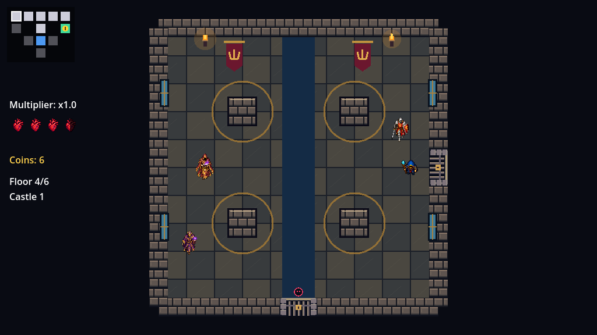
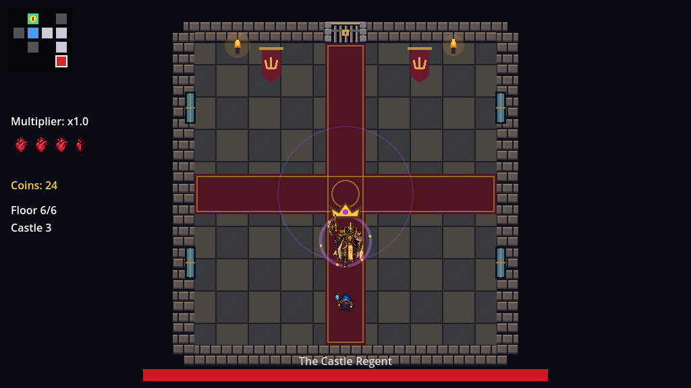

# Magic Loop — juego, assets y validación

## Configuración de audio y ajustes de combate

- **Settings / Einstellungen** en el menú principal y en pausa: música y efectos independientes de 0 a 100 %, con ratón o flechas. Se guardan en `user://settings.cfg` junto al idioma. Escape vuelve al menú de pausa sin reanudar la partida.
- El ojo muestra una descarga frontal y radial, sin el haz lateral incrustado en el dibujo. Los proyectiles del enemigo normal que dispara en cruz recorren como máximo **240 píxeles**, independientemente de su velocidad.
- Nuevas hojas de invocadores con márgenes transparentes; las regiones y los puntos de apoyo se ajustan por fotograma para evitar recortes y fragmentos vecinos.
- El arquero jefe tiene una secuencia de **tres teletransportes y tres flechas**. Mantiene al menos **160 píxeles** respecto al jugador, comprueba espacio libre y línea de visión, avisa durante **0,55 s** al reaparecer y deja **0,4 s** tras cada disparo. Empieza disponible a los 7 s; tras usarlo descansa **10–13 s** y vuelve al ataque normal. Pausa y derrota interrumpen correctamente la secuencia.
- Los jefes conservan su pose al recibir daño; solo muestran un destello rojo de **0,17 s**.

El proyecto y el ZIP de esta versión incluyen estos cambios. Se han validado con 14 baterías de pruebas automatizadas, incluida la seguridad de los teletransportes en seis diseños de sala.


## Magic Loop: animaciones, música y equilibrio

- Vara: un disparo cada **0,48 s** (antes 0,4) y **220 píxeles de alcance**, algo menos de media sala. Las mejoras de velocidad no amplían ese alcance.
- Trece hojas de personajes con poses de caminar, preparación, ataque y derrota; vistas frontal, trasera y lateral. El perfil izquierdo se refleja de las poses derechas para conservar coherencia. Se mantienen las animaciones direccionales del mago.
- La cripta tiene seis diseños: corredor funerario, sepulturas, canales, círculo ritual, osario y mosaico derruido.
- Se eliminan los avisos «Green coin: Shop» y «Tab: Run time»; la tienda y el reloj siguen funcionando.

- **Una tienda garantizada por nivel**, marcada desde el inicio con una moneda verde en el minimapa. Dos corazones a 3 monedas y un pasivo a 15; compra con E.
- Los arqueros disparan **flechas orientadas**. El castillo usa arqueros humanos, caballeros, hechiceros y guardianes acorazados; la cripta conserva sus criaturas. Los invocadores y zombis llevan hábitos de culto distintos en cada zona, con movimiento, ataque, daño y derrota animados.
- El **invocador no ataca ni hace daño por contacto**. Tiene 8 puntos de vida base y cada 3,5 segundos intenta crear un zombi más rápido que el melee habitual, en una posición libre y alejada del jugador. Hay un máximo de cuatro zombis vivos por sala; no dan monedas ni corazones y deben derrotarse para abrir las puertas.
- El jefe melee se detiene, tiembla y marca una línea antes de embestir hacia la posición fijada del jugador. El Castle Warden elige al azar cruz (42,5 %), X (42,5 %) o un anillo con hueco para escapar (15 %). Los intervalos de las embestidas y las ráfagas de los demás jefes también varían; el arquero jefe puede lanzar tres flechas.
- El Regent elige sus tres ataques al azar, sin repetir el inmediatamente anterior. Reduce los avisos de abanico/embestida a 0,40/0,45 segundos (0,33/0,38 en fase dos), aumenta el abanico y el tamaño y alcance de la embestida. Su anillo tiene una animación de 0,18 segundos, sin marcas de aviso sobre el suelo, y conserva un hueco para esquivarlo.
- Corazones de suelo y tienda más pequeños. Curación aleatoria: **5 %** por enemigo normal y **25 %** por jefe intermedio; los invocados y el jefe final no sueltan corazones.
- Los portales colocan al jugador **en el centro** y cancelan cualquier dash o retroceso pendiente. Se mantienen los movimientos diagonales normalizados, también al disparar y deslizarse junto a paredes.
- La vida se muestra con corazones, sin el contador numérico duplicado. Se retira la instrucción de buscar el tesoro como objetivo principal.
- Mantén **Tab** para ver el tiempo de la partida, incluso en pausa. Conserva el tiempo entre niveles, se detiene en pausa/derrota/victoria y se reinicia al empezar una nueva partida.
- El castillo tiene seis diseños de suelo y decoración: pasillo con alfombra cruzada, galería circular, biblioteca, alfombras gemelas, sala de banquetes y mosaico ceremonial. Los obstáculos dibujados coinciden con sus colisiones.

### Música y efectos

Trece pistas instrumentales originales: tres de exploración para la cripta, tres para el castillo, tres encuentros de jefe en la cripta y cuatro en el castillo, incluido el Regent. Las tres pistas de cada zona se barajan al comenzar: cada nivel tiene una distinta y ninguna vuelve a seleccionarse en otro nivel de la misma partida. La cripta usa drones graves y campanas; el castillo, cuerdas pulsadas y armonías medievales solemnes. La música se repite sin reiniciarse al cambiar entre salas normales; cambia al entrar en combate con un jefe y vuelve al tema de exploración al derrotarlo. Se pausa con el juego. Doce efectos breves cubren vara, arco, magia enemiga, impactos, golpes, daño, derrotas, carga, monedas, invocación y gemidos de zombis. La vara tiene un pulso suave de 0,16 s a −24 dB; los zombis gimen cada 4–7 s mientras siguen vivos, con un límite global para evitar superposición excesiva. La muerte del jugador tiene un efecto discreto de 0,6 segundos.

No se utilizaron grabaciones, melodías ni samples de terceros. Los archivos generados se ofrecen bajo CC0 1.0; la licencia y procedencia están en `Assets/Audio/LICENSE.md`. El generador reproducible es `Tools/generate_audio.py` en la raíz del repositorio (necesita Python, NumPy y FFmpeg; no son necesarios para jugar).

[Demostración con audio](Documentation/gameplay_with_audio.mp4) · [Licencia del audio](Assets/Audio/LICENSE.md)


## Abrir y jugar

1. Extrae el ZIP actualizado en una carpeta vacía.
2. Importa `Magic Loop/project.godot` con **Godot 4.3 .NET** y **.NET SDK 8**. La edición estándar no ejecuta C#.
3. Compila con Build del editor o `dotnet build` desde esta carpeta.
4. Pulsa **F5** y elige **Play**.

WASD: movimiento. Flechas: disparo. Espacio: dash. Escape: pausa. E: comprar al acercarse a un expositor de la tienda.

Arranca a pantalla completa y se adapta al monitor, incluido Full HD (1920 × 1080). Salas y menús mantienen su proporción 16:9; otras proporciones usan bandas para evitar recortes. Si el editor incrusta el juego en su panel, ejecútalo en una ventana independiente para ver la pantalla completa.

En todos los menús puedes seleccionar con cualquiera de las cuatro flechas, confirmar con Enter/Espacio o usar el ratón. La primera opción recibe el foco al abrirlos y la navegación vuelve al inicio al llegar al final. Espacio al confirmar no activa el dash al regresar al juego.

El juego empieza en inglés. El botón de idioma del menú principal alterna inglés y alemán y actualiza el texto inmediatamente. La preferencia se guarda en `user://settings.cfg`, fuera del proyecto, y se conserva al reiniciar. Los menús, HUD, instrucciones, nombres de niveles, portales, jefes y objetos se muestran en el idioma elegido. El título propio sigue siendo «Magic Loop».


[Menú en alemán](Documentation/menu_german.png) · [Selección por teclado durante la pausa](Documentation/pause_keyboard.png)

## Seis niveles y dos entornos

| Niveles | Entorno | Final del nivel |
| --- | --- | --- |
| 1–3 | Ash Crypt / Aschekrypta | Jefe y portal garantizado. El portal del nivel 3 lleva al castillo. |
| 4–5 | Castle / Schloss | Jefe más resistente y portal garantizado. |
| 6 | Castle / Schloss | The Castle Regent / Der Schlossregent; su derrota termina en victoria. |

Cada nivel genera un árbol conectado de 12 habitaciones en una cuadrícula de 5 × 5: una entrada, ocho salas de combate, un tesoro, una tienda y una sala de jefe. Las conexiones pueden ir arriba, abajo, izquierda y derecha. El jefe ocupa uno de los extremos más alejados de la entrada. Las salas de combate distribuyen seis variantes de obstáculos; aparecen todas en cada nivel. También varían la mezcla y posición de los enemigos.

Las puertas bloquean el paso durante el combate y se abren al eliminar a todos los enemigos. Las habitaciones se conservan durante la exploración del mismo nivel: volver no regenera enemigos ni tesoros recogidos, y mantiene los corazones que hayan quedado. El minimapa revela las habitaciones descubiertas. Al pasar por un portal se conservan vida, jugador y mejoras; el mapa y las salas se sustituyen por los del siguiente nivel.

Los niveles 1–3 mantienen la cripta. En el cuarto cambia el entorno al castillo, con mármol, alfombras, estandartes y ventanas; este aspecto se conserva en los niveles 4–6. La resistencia y cantidad de enemigos aumentan gradualmente. Su velocidad normal sigue por debajo de la velocidad inicial del jugador; las embestidas del jefe final son ataques breves y avisados.

El autoload `DungeonManager` expone `SeedOverride`: 0 elige una semilla aleatoria. La semilla determina los mapas, sus contenidos y los objetos. Los corazones soltados mantienen su tirada independiente. Los portales ya no se sortean: aparecen siempre en los niveles 1–5. El sexto termina con la pantalla de victoria.




[Portal de la cripta al castillo](Documentation/zone_portal.png) · [Vista previa de la progresión](Documentation/roguelike_preview.gif)

## Un pasivo gratuito por nivel y mejoras de tienda

La partida baraja seis mejoras gratuitas de tesoro y reparte exactamente una por nivel, sin repetición. Cada tienda vende además un pasivo acumulable; puede repetir una mejora, que vuelve a aumentar la estadística. La tienda excluye la penetración, cuyo efecto no se acumula. Cada una tiene un icono distinto que representa su efecto. El objeto mostrado, el texto traducido y la mejora proceden del mismo recurso `ItemData`.

| Icono / objeto | Efecto |
| --- | --- |
| Heart Medallion / Herzmedaillon | +1 corazón máximo completo y curación de esa cantidad. |
| Winged Boot / Geflügelter Stiefel | +15 % de velocidad de movimiento. |
| Spell Hourglass / Sanduhr des Zaubers | −20 % de espera entre disparos. |
| Ruby Blade / Rubinklinge | +25 % de daño de los proyectiles. |
| Piercing Tip / Durchdringende Spitze | Los proyectiles atraviesan un enemigo adicional. |
| Arcane Lens / Arkane Linse | +25 % de velocidad de los proyectiles. |


La hoja y la punta representan mejoras pasivas; el mago sigue llevando su vara. La lente nueva usa un SVG propio, con un rayo y trazos de velocidad, y se presenta al mismo tamaño que los demás objetos.

## Tienda, moneda y dificultad progresiva

Cada nivel tiene una tienda en un extremo del mapa. Su puerta y su casilla descubierta usan un distintivo verde. No hay enemigos en la tienda. Ofrece dos corazones completos a 3 monedas por unidad y un pasivo a 15. El stock se agota al comprar, no se repone al salir y entrar, y se renueva al avanzar al siguiente nivel. El pasivo muestra su efecto antes de confirmar con E.

Los enemigos normales tiran una moneda con probabilidad del 35 %. Los cinco jefes intermedios dejan una pila de tres monedas. Las monedas se recogen por contacto una sola vez y las no recogidas permanecen en la sala. El monedero, limitado a 99, se conserva entre niveles; reiniciar la partida lo pone a cero. No se puede comprar sin saldo, estando en pausa o muerto. Comprar un corazón con la vida completa no gasta monedas ni consume stock.


[Tienda en el castillo](Documentation/castle_shop.png) · [Economía y muestra de equilibrio](Documentation/ECONOMY.md)

Todos los enemigos con proyectiles, incluidos los jefes, tienen una protección de entrada de **1,5 s** durante la cual no disparan. El temporizador no avanza durante la pausa y se restablece al reactivar una sala. Después se aplica la cadencia del enemigo o su patrón de jefe. La protección impide disparos; los enemigos pueden moverse durante ese intervalo.

| Nivel | Velocidad de movimiento | Intervalo entre disparos | Velocidad de proyectil |
| --- | --- | --- | --- |
| 1 | ×0,80 | ×1,45 | ×0,75 |
| 2 | ×0,86 | ×1,32 | ×0,81 |
| 3 | ×0,92 | ×1,19 | ×0,87 |
| 4 | ×0,98 | ×1,06 | ×0,93 |
| 5 | ×1,04 | ×0,93 | ×0,99 |
| 6 | ×1,10 | ×0,80 | ×1,05 |

Los multiplicadores se aplican a los valores base de cada tipo. Un intervalo menor significa disparos más frecuentes. El movimiento normal se limita a 130 px/s, por debajo de los 150 px/s iniciales del jugador; las embestidas avisadas del Regente mantienen sus propias velocidades. Se conservan el crecimiento gradual de vida y cantidad de enemigos y los avisos de sus ataques.

Los melee utilizan una cuadrícula A* con espacio para su cuerpo alrededor de los obstáculos. Avanzan hacia el punto visible más lejano de la ruta y recalculan cada 0,2 s o al chocar. También pueden salir de una posición pegada al borde de una estructura; el margen de navegación no los deja atrapados.

## Contacto cuerpo a cuerpo y jefe final

Tras tocar al jugador, el enemigo retrocede durante 0,22 s y se recupera durante 0,28 s antes de perseguirlo de nuevo. El retroceso usa colisiones reales y busca una dirección libre cuando hay una pared detrás. El jugador recibe empuje solo si el contacto ha causado daño: la invulnerabilidad por daño o dash impide nuevos empujes. El comportamiento también se aplica a jefes que golpean por contacto.

El Regente tiene 140 puntos de vida, una corona y un aura propias sobre su sprite animado. Alterna tres ataques:

- Abanicos de proyectiles dirigidos hacia la posición anunciada del jugador.
- Anillos de proyectiles con una abertura de 72 grados, marcada durante el aviso.
- Una embestida con dirección fijada durante el aviso, que termina al chocar o agotar su recorrido.

A la mitad de vida entra en una segunda fase: más proyectiles y ráfagas, avisos algo más cortos y una embestida más rápida. Todos los ataques tienen preparación y recuperación. La pausa congela ataques y proyectiles. Al morir, el jefe detiene sus ataques y elimina sus proyectiles restantes.



[Victoria tras el sexto nivel](Documentation/victory.png)

## Animaciones y archivos

El mago tiene poses propias en cuatro direcciones. La animación del lanzamiento sigue la dirección del disparo aunque camines hacia otro lado; proyectiles y destellos salen de la punta de la vara usando los cuatro valores `CastOffset`. Los enemigos usan sus secuencias de reposo, movimiento, ataque, daño y muerte con volteo horizontal.

La prioridad de estados es muerte, daño, dash, ataque, movimiento y reposo. Al morir un enemigo se desactiva su combate inmediatamente; la presentación permanece brevemente para terminar la animación. Los objetos aplican el efecto una sola vez y desaparecen con una animación. Proyectiles, puertas, portales, antorchas e interfaz tienen efectos animados.

[Disparos del mago](Documentation/mage_casting_preview.gif) · [Galería de animaciones](Documentation/animations_preview.gif)

- `Scripts/Common/Localization.cs`: elección persistente del idioma y textos bilingües.
- `Scripts/UI/MenuMotion.cs`: foco, vecinos de navegación y presentación de botones.
- `Scripts/Rooms/DungeonFloor.cs`: generación por semilla y elección de habitaciones/jefe.
- `DungeonManager.cs`: partida, caché de habitaciones y progresión de seis niveles.
- `Room.cs`, `RoomLayouts.cs`, `RoomArt.cs` y `ZonePortal.cs`: contenido, geometría, entornos y portales.
- `Scripts/Enemies/Enemy.cs`: combate, protección inicial y separación después del contacto.
- `Scripts/Enemies/Difficulty.cs`: escalado de movimiento, cadencia y proyectiles.
- `Scripts/Rooms/RoomNavigation.cs` y `Scripts/Enemies/EnemyMelee.cs`: rutas alrededor de obstáculos.
- `Scripts/Items/Economy.cs`, `CoinPickup.cs` y `ShopOffer.cs`: precios, moneda y compras.
- `Scripts/Enemies/CastleBoss.cs`: ataques, fases y presentación del jefe final.
- `Scripts/Items/ItemCatalog.cs` y `Resources/Items/`: seis mejoras, iconos y textos en ambos idiomas.
- `Assets/Sprites/hero_mage_directional.png` y `hero_mage_manifest.json`: atlas y regiones del mago.
- `Assets/Sprites/Directions/` y `Resources/Animations/Directions/`: trece hojas direccionales de enemigos y jefes; `Tools/build_directional_frames.py` genera los recursos de fotogramas sin modificar los PNG. Los antiguos atlas de enemigos fueron retirados.
- `Assets/Sprites/dungeon_atlas.png`: iconos y proyectiles activos; `arcane_lens.svg`: sexto icono.

Los gráficos originales de reemplazo, recursos estáticos sustituidos y escenas del recorrido fijo ya fueron eliminados. Los atlas compartidos permanecen completos porque contienen regiones activas. Las imágenes de `Documentation/` son referencias y no se cargan durante el juego. Las hojas del mago y los enemigos se generaron con IA; no se usaron packs comerciales ni se atribuye una licencia nueva a los archivos originales.

## Comprobaciones

Desde esta carpeta, con Godot **.NET** y .NET SDK 8 en PATH:

```sh
dotnet build
godot --headless --editor --path . --quit
godot --headless --fixed-fps 60 --path . --script res://Tests/RoguelikeSmoke.gd
godot --headless --fixed-fps 60 --path . --script res://Tests/CombatSafetySmoke.gd
godot --headless --fixed-fps 60 --path . --script res://Tests/EconomySmoke.gd
godot --headless --fixed-fps 60 --path . --script res://Tests/LootBalanceSmoke.gd
godot --headless --fixed-fps 60 --path . --script res://Tests/MenuLanguageSmoke.gd
godot --headless --fixed-fps 60 --path . --script res://Tests/MeleeContactSmoke.gd
godot --headless --fixed-fps 60 --path . --script res://Tests/FinalBossSmoke.gd
godot --headless --fixed-fps 60 --path . --script res://Tests/AnimationSmoke.gd
godot --headless --fixed-fps 60 --path . --script res://Tests/MageCastingSmoke.gd
godot --headless --fixed-fps 60 --path . --script res://Tests/ExpansionSmoke.gd
godot --headless --fixed-fps 60 --path . --script res://Tests/EnemyPatternsSmoke.gd
godot --headless --fixed-fps 60 --path . --script res://Tests/MagicLoopSmoke.gd
```

Las pruebas comprueban 1.200 mapas con una tienda y un tesoro por nivel, puertas físicas en las cuatro direcciones, recorrido de los seis niveles, un objeto distinto por nivel, transición de entorno en el cuarto, conservación de mejoras, portales garantizados, victoria y reinicio. Las pruebas de menú envían teclas reales y arrancan procesos nuevos de Godot para comprobar la persistencia. Las pruebas de combate comprueban separación física, paredes, invulnerabilidad y los tres ataques del jefe final, incluyendo contacto real durante su embestida. Las nuevas pruebas cubren la espera de 1,5 s en los seis tipos de enemigo con proyectiles, la pausa del temporizador, dificultad creciente y rutas físicas en las seis variantes de sala. Comprueban monedas recogidas una sola vez, compras con E, saldo insuficiente, rechazo de curación con vida completa, stock agotado, revisitas, pausa y transición de nivel. Una muestra de 90 niveles y 2.151 enemigos valida la proporción de monedas.

Desde la raíz del repositorio, `python3 Tools/audit_assets.py` comprueba referencias, recursos visuales sin uso y seis iconos/efectos distintos. El paquete excluye `.godot`, metadatos `.import` regenerables y compilados; contiene entradas de carpetas para Godot. Antes de distribuirlo se valida extracción, compilación y pruebas desde una copia limpia.

Las pruebas de progresión y las vistas previas usan derrotas controladas, protección del jugador y fondos de prueba para las compras; no equivalen a una partida completa ganada sin asistencia.

La batería `MagicLoopSmoke.gd` comprueba 300 repartos musicales sin repetición, cadencia real con teclado, alcance a tres velocidades, sonido al recoger monedas, gemidos de zombis vivos, poses direccionales y decisiones del Regent en seis semillas. Los nombres internos del proyecto C# se conservan por compatibilidad; el título, carpeta distribuida y archivo ZIP se llaman Magic Loop.

Pruebas adicionales: `Tests/LocalAdjustmentsSmoke.gd` (audio persistente, teclado, pausa, alcance y secuencia del arquero) y `Tests/BlinkSafetySmoke.gd` (destinos de teletransporte en las seis distribuciones con colisiones reales).
