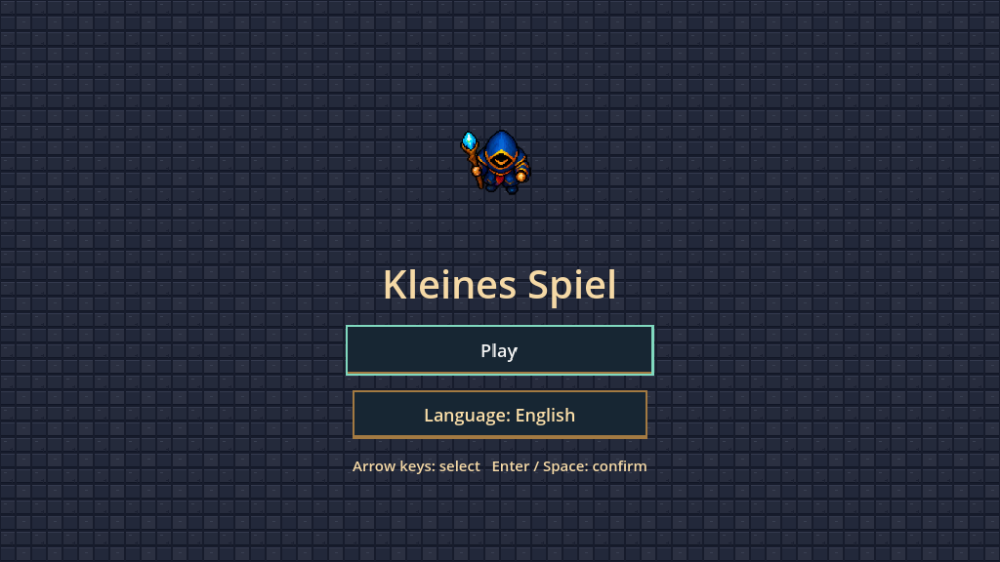
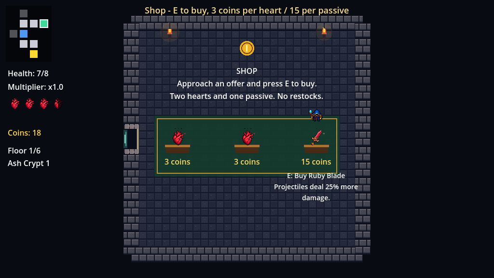

# Kleines Spiel

Roguelike 2D en Godot y C#: un mago con vara explora una cripta, asciende al castillo y se enfrenta al Regente.

## Descargar y jugar

**[Descargar KleinesSpiel_con_assets.zip](https://github.com/JustmeJs/JustmeJs/raw/refs/heads/main/KleinesSpiel_con_assets.zip)**

Extrae el ZIP en una carpeta nueva e importa `KleinesSpiel/project.godot` con **Godot 4.3 .NET** y **.NET SDK 8**. Compila, pulsa **F5** y selecciona **Play**.

- Juego: WASD para moverse, flechas para disparar, espacio para dash y Escape para pausar y **E para comprar** cerca de un expositor.
- Todos los menús: flechas para seleccionar y **Enter o Espacio** para confirmar; también admiten ratón.
- Idioma: inglés predeterminado. El botón **Language: English / Sprache: Deutsch** del menú principal cambia el idioma y guarda la elección entre sesiones.



## De la cripta al castillo

La partida tiene **seis niveles**: tres de cripta y tres de castillo. Cada nivel genera **12 habitaciones** conectadas en las cuatro direcciones, con bifurcaciones, seis distribuciones de obstáculos y enemigos variados. El minimapa revela las habitaciones descubiertas; las salas limpiadas y los objetos recogidos conservan su estado al regresar.

Hay **un objeto pasivo gratuito de tesoro por nivel**, elegido sin repetir entre las seis mejoras, y **una tienda** que vende dos corazones y un pasivo adicional. Después de cada uno de los cinco primeros jefes aparece siempre un portal al siguiente nivel. El tercer portal conduce al castillo, con suelo de mármol, alfombras, estandartes y ventanas. Mantienes vida y mejoras al avanzar.

En el sexto nivel espera **The Castle Regent**, un jefe de 140 puntos de vida con abanicos de proyectiles, anillos con una abertura para esquivar y embestidas que avisan de su dirección. Por debajo de la mitad de vida intensifica sus ataques. Derrotarlo completa la partida.


La vista previa usa encuentros, derrotas y monedas de demostración controladas para mostrar la progresión y las compras.

## Tiendas, monedas y dificultad

Los enemigos normales tienen un **35 %** de probabilidad de soltar una moneda; los cinco jefes intermedios dan **3 monedas**. Cada tienda vende dos corazones completos a **3 monedas cada uno** y una mejora pasiva a **15**. Acércate y pulsa **E**: los precios y el efecto aparecen antes de comprar. No se cobra curación si ya tienes toda la vida. El dinero y las compras se conservan al volver a una sala; el monedero llega hasta 99 y se reinicia con la partida.



Los enemigos **no disparan durante los primeros 1,5 segundos** de entrar en una habitación. El primer nivel reduce su velocidad de movimiento y de proyectil y espacia los disparos; cada nivel aumenta la dificultad. Los melee calculan rutas alrededor de los obstáculos y las actualizan al moverse el jugador.

[Equilibrio económico, ratios y referencias consultadas](KleinesSpiel/Documentation/ECONOMY.md)

## Objetos y combate


Los enemigos cuerpo a cuerpo retroceden y se recuperan brevemente después del contacto, dejando espacio para escapar. Los golpes bloqueados por invulnerabilidad no vuelven a empujar al jugador. La embestida del jefe final termina cuando choca.

El mago apunta la vara en la dirección del disparo aunque camines hacia otro lado. Personajes, objetos, proyectiles, puertas y menús tienen animaciones.

[Disparos en cuatro direcciones](KleinesSpiel/Documentation/mage_casting_preview.gif) · [Galería de animaciones](KleinesSpiel/Documentation/animations_preview.gif)

## Desarrollo y comprobaciones

[Documentación de implementación y pruebas](KleinesSpiel/README_ASSETS.md)

Las pruebas automatizadas cubren 1.200 mapas generados, un recorrido de los seis niveles, navegación real con teclado, ambos idiomas y su persistencia, separación de enemigos melee, los tres ataques del jefe final y las animaciones existentes. También cubren los 1,5 segundos de preparación, rutas alrededor de pilares, compras, persistencia del dinero y una muestra de 2.151 enemigos para comprobar el reparto de monedas.

Desde la raíz del repositorio:

```sh
python3 Tools/audit_assets.py
python3 Tools/package_project.py
```

El empaquetador incluye los archivos del proyecto registrados en el índice de Git y crea las entradas explícitas de carpetas que necesita el importador de Godot. Excluye cachés y compilados. El ZIP es el proyecto editable y requiere Godot .NET para ejecutarlo.
