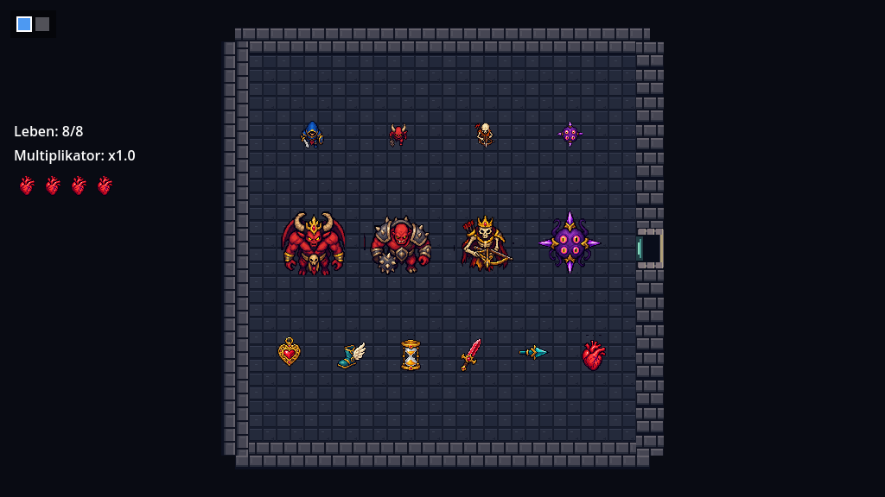

# Kleines Spiel

Juego 2D roguelike desarrollado en Godot y C#, con assets integrados de personajes, enemigos, jefes, objetos y mazmorra.

## Descargar el proyecto listo para abrir

**[Descargar KleinesSpiel_con_assets.zip](https://github.com/JustmeJs/JustmeJs/raw/refs/heads/main/KleinesSpiel_con_assets.zip)**

Extrae el ZIP e importa `KleinesSpiel/project.godot` con **Godot 4.3 .NET** y **.NET SDK 8**. Compila y pulsa **F5**. El ZIP contiene el proyecto; no es un ejecutable de Windows.

Controles: WASD para moverse, flechas para disparar, espacio para dash y Escape para pausar.

## Vista previa

La imagen muestra una composición de los sprites dentro de la sala inicial.

[Documentación de los assets y validación](KleinesSpiel/README_ASSETS.md)
