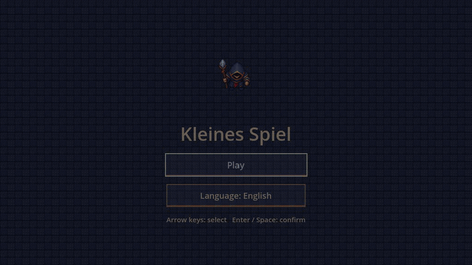
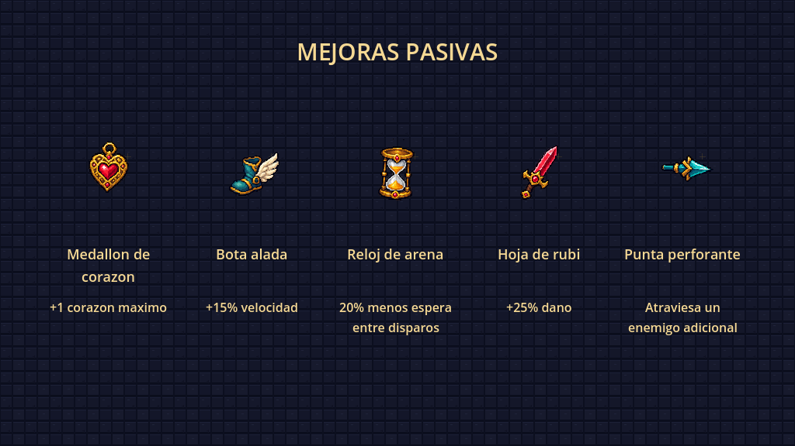

# Kleines Spiel

Roguelike 2D en Godot y C#: explora mazmorras ramificadas, recoge mejoras y derrota a sus jefes con un mago y su vara.

## Descargar y jugar

**[Descargar KleinesSpiel_con_assets.zip](https://github.com/JustmeJs/JustmeJs/raw/refs/heads/main/KleinesSpiel_con_assets.zip)**

Extrae el ZIP en una carpeta vacía e importa `KleinesSpiel/project.godot` con **Godot 4.3 .NET** y **.NET SDK 8**. Compila, pulsa **F5** y selecciona **Spielen**. Es el proyecto editable; para ejecutarlo necesitas Godot .NET.

Controles: WASD para moverse, flechas para disparar, espacio para dash y Escape para pausar. La interfaz del juego está en alemán.

## Mazmorras y progresión

Cada zona genera un mapa de **12 habitaciones conectadas en las cuatro direcciones**, con bifurcaciones, dos tesoros y un jefe al final de un camino largo. Las salas de combate eligen entre **seis distribuciones** de obstáculos y combinaciones de enemigos. Las puertas se abren al terminar el combate; el minimapa revela las salas descubiertas. Al regresar, se conserva lo que has limpiado o recogido.

Después del primer jefe hay un **70 % de probabilidad** de que aparezca un portal a las **Ruinas de Amatista**, una segunda mazmorra con otro mapa, otro aspecto y un jefe final distinto. Conservas vida y mejoras. Si no aparece el portal, ganas al completar la primera zona; el jefe de la segunda cierra la partida cuando sí aparece.



La vista previa usa una semilla fija y derrotas controladas para mostrar el recorrido y los dos entornos.

## Objetos pasivos y combate

Cada mejora tiene un icono propio que representa su efecto. Las dos salas de tesoro de cada zona eligen objetos al azar, sin repetirlos en la misma partida.



El mago tiene animaciones direccionales de movimiento y lanzamiento: la vara apunta hacia el disparo aunque camines hacia otro lado. Enemigos, jefes, objetos, proyectiles, puertas e interfaz también están animados.

[Ver disparos en cuatro direcciones](KleinesSpiel/Documentation/mage_casting_preview.gif) · [Galería de animaciones](KleinesSpiel/Documentation/animations_preview.gif)

Se retiraron los sprites originales sin uso, los recursos estáticos sustituidos y las escenas del antiguo recorrido fijo. La auditoría comprueba las referencias de los gráficos conservados y los cinco iconos pasivos distintos.

## Desarrollo y validación

Compilación con .NET 8 y pruebas en Godot 4.3 .NET: generación de 400 mapas, tránsito físico por puertas, recorrido de ambas zonas, conservación de objetos y salas, portal, victoria, reinicio, animaciones y disparos direccionales.

[Documentación de implementación y pruebas](KleinesSpiel/README_ASSETS.md)

Desde la raíz del repositorio:

```sh
python3 Tools/audit_assets.py
python3 Tools/package_project.py
```

El empaquetador usa los archivos del proyecto incluidos en el índice de Git. El ZIP contiene entradas explícitas de carpetas para el importador de Godot y excluye cachés y compilados.
